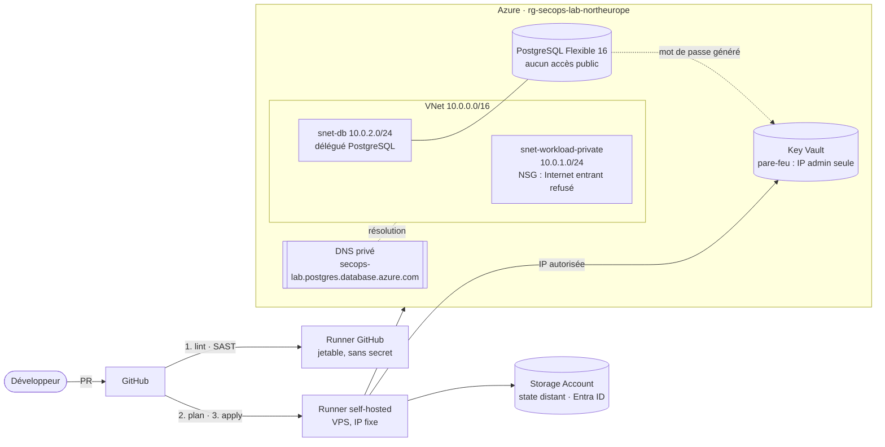

# Hardened Azure Infrastructure

[](https://github.com/xoudev/hardened-azure-infrastructure/actions/workflows/terraform-ci.yml)


Infrastructure Azure décrite en Terraform et livrée par un pipeline GitHub Actions, avec la sécurité
intégrée à chaque étape : réseau privé, base de données sans IP publique, secrets dans Key Vault,
state distant authentifié par Entra ID, contrôles statiques avant tout plan, relecture humaine avant tout apply.

C'est un **lab d'apprentissage DevSecOps** que je construis par itérations. Ce README dit ce qui est fait,
ce qui est volontairement accepté comme risque, ce que j'ai appris et ce qu'il me reste à apprendre.

> L'API déployée sur cette infrastructure vit dans [`hardened-flask-app`](https://github.com/xoudev/hardened-flask-app).

---

## Sommaire

1. [Architecture](#architecture)
2. [Ce qui est déployé](#ce-qui-est-déployé)
3. [Le pipeline CI/CD](#le-pipeline-cicd)
4. [Mesures de sécurité et pourquoi](#mesures-de-sécurité-et-pourquoi)
5. [Risques acceptés](#risques-acceptés)
6. [Ce que j'ai appris](#ce-que-jai-appris)
7. [Ce qu'il me reste à apprendre](#ce-quil-me-reste-à-apprendre)
8. [Lancer le projet](#lancer-le-projet)
9. [Structure du dépôt](#structure-du-dépôt)

---

## Architecture



Pourquoi deux runners : les contrôles statiques n'ont besoin d'aucun secret, ils tournent donc sur un runner
GitHub jetable. Seuls `plan` et `apply` ont besoin d'atteindre le Key Vault, dont le pare-feu n'autorise que l'IP
de mon VPS. Ils tournent sur le runner self-hosted.

## Ce qui est déployé

| Ressource | Détail |
|---|---|
| Resource Group | `rg-<projet>-<env>-<région>`, tags `environment`, `ManagedBy`, `Owner` |
| Réseau | VNet `10.0.0.0/16`, sous-réseau workload `/24`, sous-réseau base de données `/24` délégué à `Microsoft.DBforPostgreSQL/flexibleServers` |
| NSG | Règle explicite `Deny-Internet-Inbound` (priorité 4096) associée au sous-réseau workload |
| PostgreSQL Flexible Server 16 | SKU `B_Standard_B1ms`, `public_network_access_enabled = false`, intégration VNet, DNS privé, `log_connections` et `log_checkpoints` activés |
| Key Vault | Pare-feu `default_action = Deny` + IP admin, bypass `AzureServices`, soft delete 7 jours, mot de passe de la base stocké avec date d'expiration |
| Mot de passe de la base | Généré par `random_password` (20 caractères, complexité imposée), jamais écrit dans le code |
| State Terraform | Storage Account dédié (TLS 1.2 minimum, accès blob public interdit), authentification Entra ID, verrouillage natif |

## Le pipeline CI/CD

Deux workflows dans [`.github/workflows`](.github/workflows) :

| Workflow | Déclencheur | Rôle |
|---|---|---|
| `terraform-ci.yml` | PR vers `main` et push sur `main` | Contrôles statiques → plan → apply |
| `terraform-destroy.yml` | Manuel uniquement | Détruit l'infrastructure (confirmation en toutes lettres) |

Les trois phases de `terraform-ci.yml` :

1. **Lint & SAST** (runner GitHub jetable, aucun secret, `contents: read`)
   `terraform fmt -check` · `terraform init -backend=false` · `terraform validate` · `trivy config` (HIGH et CRITICAL bloquants)
2. **Speculative Plan** (runner self-hosted)
   Plan commenté automatiquement sur la PR sous forme de tableau de conformité. Le commentaire est mis à jour
   à chaque commit au lieu d'être dupliqué. Jamais exécuté pour une PR venant d'un fork.
3. **Apply** (runner self-hosted, uniquement après un merge sur `main`)

Durcissements du pipeline :

- `permissions: {}` au niveau du workflow, puis le strict nécessaire par job
- toutes les actions tierces **épinglées par SHA de commit** (un tag comme `v4` peut être réécrit)
- version de Terraform figée (`1.17.1`) et fichier `.terraform.lock.hcl` commité
- `concurrency` : un seul run à la fois sur le state, sans annulation d'un apply en cours
- le workflow de destroy exige de taper `destroy`, la saisie passe par une variable d'environnement
  (pas d'interpolation directe dans le script, donc pas d'injection de commande)
- le plan est supprimé du disque du runner en fin de job

## Mesures de sécurité et pourquoi

| Mesure | Pourquoi |
|---|---|
| Base PostgreSQL sans accès public, injectée dans le VNet | Réduire la surface d'attaque : la base n'a pas d'adresse joignable depuis Internet |
| DNS privé lié au VNet | Le nom du serveur se résout vers une IP privée uniquement |
| Key Vault en `Deny` par défaut + liste d'IP | Un secret volé n'est inutile que si on peut atteindre le coffre |
| Mot de passe généré puis rangé dans Key Vault | Aucun mot de passe en clair dans le dépôt ni dans une variable |
| State distant avec Entra ID | Pas de clé de compte de stockage à protéger ou à faire fuiter |
| Trivy config bloquant | Détecter une mauvaise configuration avant qu'elle n'existe dans Azure |
| Runner jetable pour le statique, self-hosted pour le plan | Ne donner l'accès au cloud qu'aux étapes qui en ont besoin |
| Journalisation PostgreSQL (`log_connections`, `log_checkpoints`) | Tracer les connexions : base d'une future détection |
| Région et noms en variables, suffixe aléatoire avec `keepers` | Pouvoir changer de région sans entrer en collision avec un nom réservé |

## Risques acceptés

Chaque risque est assumé, pas oublié. Ils sont aussi documentés dans le code.

| Risque | Pourquoi je l'accepte | Quand je le traite |
|---|---|---|
| `purge_protection_enabled = false` sur le Key Vault | Le lab est détruit et recréé régulièrement : la protection bloquerait la réutilisation | À activer en production |
| Mot de passe de la base présent dans le state | `random_password` écrit sa valeur dans le state. Le state est chiffré, privé, accessible par Entra ID uniquement | Remplacer par une authentification Entra sans mot de passe |
| `ARM_CLIENT_SECRET` stocké dans GitHub | Étape intermédiaire du lab | Remplacer par OIDC (voir ci-dessous) |
| `azurerm ~> 3.100` | Version de départ du lab | Migration vers la v4 prévue |
| Key Vault en *access policies* | Plus simple à lire pour un premier déploiement | Passer en RBAC |
| IP admin en valeur par défaut d'une variable | Pratique pour un lab mono-opérateur | Sortir en variable d'environnement ou secret |
| Exception `trivy:ignore:AZU-0021` sur `connection_throttling` | Paramètre non supporté par PostgreSQL Flexible Server, documentée dans le code | N/A |
| Runner self-hosted persistant | Seul moyen d'avoir une IP fixe pour le pare-feu du Key Vault | Voir « Ce qu'il me reste à apprendre » |

## Ce que j'ai appris

**Terraform**
- Le cycle `init` → `plan` → `apply` → `destroy` et surtout le rôle du **state** : ce qu'il contient (y compris les secrets), pourquoi le stocker à distance et le verrouiller.
- Les dépendances implicites par référence et explicites par `depends_on` (le DNS privé doit être lié avant la création du serveur).
- Un Key Vault supprimé garde son nom réservé 7 jours : j'ai ajouté un `keepers` sur le suffixe aléatoire pour qu'un changement de région génère un nouveau nom.
- Une migration de région (`swedencentral` puis `northeurope`) n'est pas un simple changement de variable : noms uniques, quotas, ressources supprimées mais encore réservées.
- Lire un rapport Trivy, distinguer un vrai problème d'un paramètre non supporté, et documenter l'exception à l'endroit où elle s'applique.

**Azure**
- La hiérarchie tenant → subscription → resource group → ressource.
- L'intégration d'un PostgreSQL Flexible Server dans un VNet : sous-réseau **délégué**, zone DNS privée et lien avec le VNet.
- Un NSG associé à un sous-réseau plutôt qu'à une carte réseau, et l'ordre de priorité des règles.
- Authentifier le backend du state avec Entra ID (`use_azuread_auth`) au lieu d'une clé de stockage.

**CI/CD sécurisée**
- Un pipeline a les clés du royaume : le compromettre revient à compromettre l'infrastructure. D'où les permissions minimales, les SHA épinglés et la séparation des runners.
- Pourquoi un runner **self-hosted persistant** est plus risqué qu'un runner jetable, et comment limiter le risque (utilisateur dédié sans `sudo` ni accès au socket Docker, PR de fork exclues du plan).
- Récupérer un runner en *SessionConflict* : deux machines ne doivent jamais partager la même identité de runner. Je l'ai rencontré en migrant le runner vers un nouveau serveur.
- Le rôle d'un workflow de destruction manuel et confirmé pour maîtriser les coûts d'un lab cloud.

**Méthode**
- Une branche, une PR, une CI verte avant chaque merge, des commits au format Conventional Commits.
- Casser volontairement une mesure pour vérifier qu'elle protège vraiment.

## Ce qu'il me reste à apprendre

Feuille de route, par ordre de priorité. L'objectif final : déployer l'API [`hardened-flask-app`](https://github.com/xoudev/hardened-flask-app)
sur Azure **sans aucun mot de passe stocké nulle part**.

- [ ] **Fédération OIDC GitHub → Entra ID** pour supprimer `ARM_CLIENT_SECRET` et tout secret longue durée dans GitHub
- [ ] Migration vers `azurerm` v4, nommage Cloud Adoption Framework (avec blocs `moved` pour renommer sans détruire), budget Azure et alerte de coût
- [ ] `apply` du **plan sauvegardé**, derrière un environnement GitHub avec approbation manuelle
- [ ] Identités managées et RBAC au moindre privilège (rôles intégrés, puis personnalisés)
- [ ] Azure Container Registry puis **Azure Container Apps** pour héberger l'API
- [ ] PostgreSQL avec authentification Entra (identité managée), donc plus de mot de passe dans le state
- [ ] Private endpoints pour le Key Vault et le registre
- [ ] Key Vault en RBAC, purge protection, rotation automatique des secrets
- [ ] **Observabilité** : diagnostic settings, Log Analytics, requêtes KQL (qui a lu un secret ? quelles erreurs 5xx ?), alertes Azure Monitor
- [ ] **Policy as code** : Azure Policy (tag `owner` obligatoire) et Conftest/OPA sur le plan Terraform
- [ ] Modules Terraform réutilisables, `for_each`, tests (`terraform test`, tflint, checkov)
- [ ] Protection de la branche `main`, commits signés, hooks `pre-commit` (Dependabot est déjà actif sur Terraform et GitHub Actions)
- [ ] Supply chain : SBOM, signature d'image (cosign), provenance SLSA
- [ ] Threat model STRIDE de l'architecture finale et runbook d'incident
- [ ] Remplacer le runner self-hosted persistant par un runner éphémère ou un accès privé au Key Vault

## Lancer le projet

Prérequis : Terraform ≥ 1.17, Azure CLI, un abonnement Azure.

```bash
# 1. Créer le backend du state (une seule fois)
./scripts/bootstrap-backend.sh        # note le nom du Storage Account généré, à reporter dans backend.tf

# 2. S'authentifier
az login

# 3. Adapter admin_ip_range à ton IP publique (pare-feu du Key Vault)
curl -4 ifconfig.me

# 4. Déployer
terraform init
terraform plan
terraform apply
```

Les valeurs par défaut sont dans [`variables.tf`](variables.tf).

**Coût.** Le serveur PostgreSQL Flexible est facturé tant qu'il existe. Détruis l'infrastructure entre deux sessions :
workflow **Terraform Destroy** (Actions → Run workflow, taper `destroy`) ou `terraform destroy`.

## Structure du dépôt

```
.github/workflows/
  terraform-ci.yml        Contrôles statiques → plan commenté → apply
  terraform-destroy.yml   Destruction manuelle et confirmée
scripts/
  bootstrap-backend.sh    Crée le Storage Account du state (TLS 1.2, blob privé)
backend.tf                State distant azurerm + Entra ID
providers.tf · versions.tf  Providers et contraintes de version
main.tf                   Resource Group
network.tf                VNet, sous-réseaux, NSG, DNS privé
database.tf               PostgreSQL Flexible Server et paramètres de journalisation
keyvault.tf               Key Vault, mot de passe généré, secret
variables.tf · locals.tf · outputs.tf
.terraform.lock.hcl       Versions des providers (commité volontairement)
```
